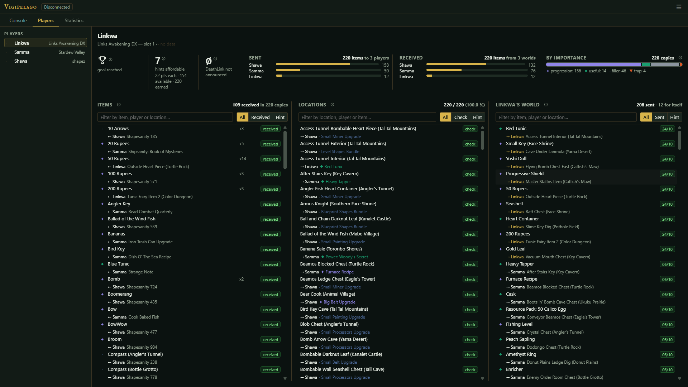
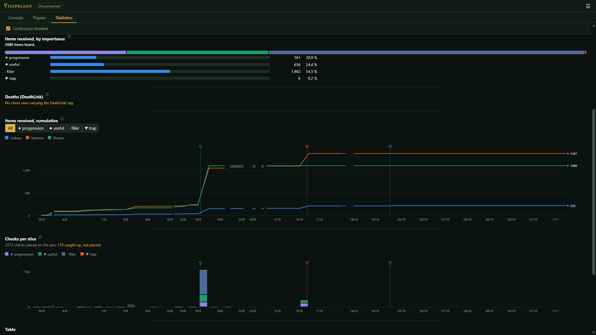

# Vigipelago

A spectator companion for [Archipelago](https://archipelago.gg) multiworld games.

Vigipelago connects to a room as a text client, listens to everything the server announces,
and keeps it in your browser: a searchable console, a page per player, and statistics over
time. It never asks the server for anything that would spoil what you have not found yet.

**Try it:** https://sawa974.github.io/vigipelago/ (nothing to install, your data stays in your browser)



## What it does

- **Console**: the server's messages, kept and searchable across sessions, with the lines
  missed while you were away caught up on reconnection (checks, hints, received items).
- **Players**: for each slot, lists of items, locations and hints, searchable by name, player
  or location: where an item came from, what a checked location held, which hints others asked
  you for. Handy when your game's tracker doesn't show them, or when you play in another
  language than Archipelago's English names. Plus progress, hint points and DeathLink deaths.
- **Statistics**: progress per player, play periods, items by importance, cumulative curves,
  checks over time, and a timeline you can scrub or replay.
- **Export and import**: save a game to a file and merge captures made on another machine.
- **Themes and languages**: dark and light themes; English and French included, and any other
  language can be added from a JSON file (see [docs/TRANSLATING.md](docs/TRANSLATING.md)).



## Principles

- **No spoilers.** Vigipelago only shows what the server announces to every player. It never
  scouts locations to reveal what they hold.
- **Your data stays in your browser.** Everything is stored locally (IndexedDB). There is no
  account and no backend: the server only serves static files.
- **Any server.** archipelago.gg or your own.
- **Nothing it cannot know.** When a number is unknown or only partly known, the screen says
  so instead of guessing.

## Running it

Requirements: Node.js 20.19 or later (the version Angular 21 requires).

```bash
npm ci
npm start            # development server on http://localhost:4200
```

To build and serve it yourself:

```bash
npm run build        # static files in dist/Vigipelago/browser
npm run serve        # serves them on http://localhost:4300
```

The build is a plain static site: any web server can host `dist/Vigipelago/browser`. An
`.htaccess` for Apache (caching, no directory listing, no search indexing) is included.

```bash
npm test             # unit tests
```

## License

Vigipelago is released under the [PolyForm Noncommercial License 1.0.0](LICENSE.md): you may
use, modify and share it for any noncommercial purpose.

**Additional permission:** using Vigipelago while streaming or recording a game, monetized or
not, is allowed.

For any other commercial use, ask the author.

## Built with Claude

Vigipelago was designed and directed by its author and written with the help of
[Claude](https://claude.ai), Anthropic's AI assistant.

## Not affiliated

Vigipelago is an independent project. It is not affiliated with or endorsed by the
Archipelago project.
